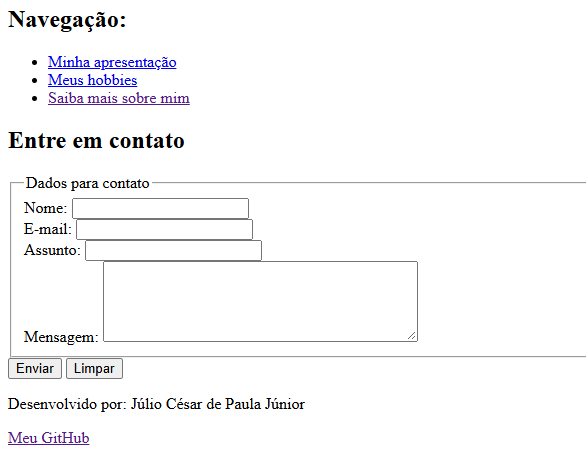
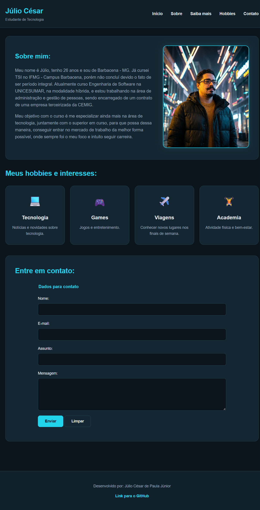

# Página Pessoal Simples

## Sobre o projeto

Este projeto foi desenvolvido como parte de uma atividade prática da disciplina de **Programação Web I**, com o objetivo de aplicar os conceitos básicos de HTML na construção de uma página pessoal.

A página apresenta informações pessoais, interesses, hobbies e links de navegação entre páginas.

## Objetivos da atividade

- Desenvolver uma página utilizando HTML.
- Conhecer e aplicar as principais tags HTML.
- Utilizar tags semânticas para organizar o conteúdo.
- Inserir imagens com descrição alternativa (`alt`).
- Criar listas e links de navegação.
- Desenvolver uma segunda página conectada à página inicial.
- Publicar o projeto no GitHub Pages.

## Estrutura do projeto

- `index.html`: página inicial e apresentação pessoal.
- `sobre.html`: página com informações adicionais.
- `minha-foto.jpg`: imagem utilizada na página pessoal.
- `README.md`: documentação do projeto.

## Tecnologias utilizadas

- HTML5
- Visual Studio Code
- GitHub
- GitHub Pages

## Acesso ao projeto

O projeto está publicado utilizando o GitHub Pages.

**Link do site:** https://cesarjr23.github.io/pagina-pessoal/

## Autor

Júlio César de Paula Júnior

Projeto desenvolvido para fins educacionais na disciplina de Programação Web I.

## Atividade 3 - Formulário de Contato

Nesta atividade da disciplina de Programação Web I, foi implementado um formulário de contato na Página Pessoal desenvolvida anteriormente.

### Funcionalidades implementadas

- Campo para nome;
- Campo para e-mail com validação HTML;
- Campo para assunto;
- Área de texto para mensagem;
- Validação de campos obrigatórios;
- Botão Enviar;
- Botão Limpar;
- Organização dos campos com fieldset e legend.

### Captura de tela

## Atividade 4 - Estilização da Página Pessoal com CSS

Nesta atividade da disciplina de Programação Web I, foi realizada a estilização da Página Pessoal desenvolvida nas atividades anteriores, utilizando CSS externo.

O objetivo foi melhorar a apresentação visual do site, mantendo sua estrutura HTML e aplicando conceitos de estilização aprendidos durante as aulas.

### Estilizações implementadas

- Criação do arquivo externo `style.css`;
- Aplicação do tema escuro Dark Tech, com detalhes em ciano;
- Personalização das cores, fontes e títulos;
- Estilização do cabeçalho e do menu de navegação;
- Organização da apresentação pessoal em um card com imagem;
- Criação de cards para os hobbies e interesses;
- Aplicação de bordas arredondadas, margens e espaçamentos;
- Estilização do formulário de contato e seus botões;
- Personalização do rodapé;
- Padronização visual das páginas `index.html` e `sobre.html`;
- Aplicação de efeitos visuais em elementos interativos.

### Tecnologias utilizadas

- HTML5 — estrutura das páginas;
- CSS3 — estilização e organização visual;
- Git e GitHub — versionamento do projeto;
- GitHub Pages — publicação do site.

### Captura de tela

